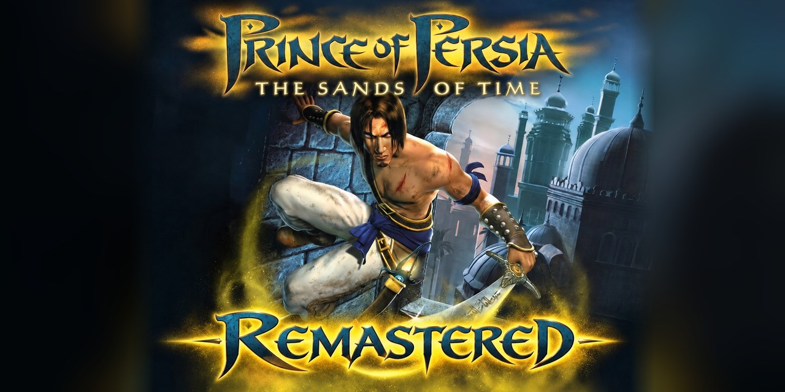

# Prince of Persia: The Sands of Time Remastered



A native Windows port of *Prince of Persia: The Sands of Time*, Gameloft's 2003 side-scrolling
*Prince of Persia* made for J2ME (mobile Java) phones. It is the original game's own code,
decompiled and translated to C++, not emulated, and adds widescreen, high frame rates and modern
controls.

**Status: 1.0.0.** All eight levels, the sand powers, the menus and saving work. At the original
176-pixel width the engine matches the original game's code field for field across tens of
thousands of fuzzed ticks in every level. A complete human playthrough has not been recorded, so
please [open an issue](https://github.com/samioan/pop-sot-j2me-remastered/issues) if anything
goes wrong; the launcher picks up fixes automatically.

| Original | Launcher | You supply |
|---|---|---|
| Nokia Series 60 build, 176x208, MIDlet 1.1.0 | `PrinceOfPersiaSoT.exe` | `PrinceOfPersia-TheSandsOfTime.jar` (that build) |

## Download and play

**The game is not included.** It belongs to its rights holders, so you need your own copy of the
Series 60 `.jar` (SHA-256 `40e7115a...`). Other builds with the same layout are offered with a
warning and are untested.

1. Download the zip from the
   [Releases page](https://github.com/samioan/pop-sot-j2me-remastered/releases) and unzip it
   anywhere.
2. Run **PrinceOfPersiaSoT.exe** and choose your `.jar`, or put the `.jar` next to the launcher
   first and it is picked up by itself. The launcher checks it and keeps a copy in `game\`.
3. Pick a window size or fullscreen and press **Play**.

There is no installer, and no Visual C++ redistributable is needed. The launcher checks GitHub for
newer builds on start-up, offers an **Update** button when there is one, and keeps your JAR,
settings and saves.

### What the port adds

| | |
|---|---|
| Widescreen | Original 176, Auto, 4:3, 16:10, 16:9, 21:9 |
| Frame rate | Original, your display's rate, fixed caps or unlimited, with interpolated frames |
| Game speed | Stays at the original 12.5 logic steps a second |
| Fullscreen | F11 or Alt+Enter toggles it |
| Controls | Keyboard and XInput gamepad, rebindable; newest direction wins; optional input buffer |

Widescreen shows more of the level and never stretches sprites or the HUD. The options are in
**Settings > PC options**, in the main menu and the in-game menu. F1 shows the controls; the zip's
`README.txt` lists them and every shortcut.

The input buffer (on by default, keyboard page) lets a jump or sword press you are still holding
count when the prince could not act on it yet: Right and Up together from standing make a running
jump, and a jump pressed while landing happens on landing. Turn it off for the original timing.

### Troubleshooting

The music and sound effects are the phone's ringing tones converted to MIDI and played through
the Windows synthesizer, so they sound different from the phone; that is expected.

Settings and the save live in `%LOCALAPPDATA%\PrinceOfPersiaSoT\`; the game files stay in `game\`
next to the launcher. To uninstall, delete the game's folder, and that one too if you want to
remove your save.

## How it was made

The JAR is plain JVM bytecode with obfuscated names, so
[Vineflower](https://github.com/Vineflower/vineflower) recovers close-to-original Java. The classes
were renamed (Game, Actor, Prince, Level, Sprite), decompiler artifacts were checked against the
original bytecode (`tools/check_narrowing.py`), and the result compile-checks.

The port is translated mechanically: `tools/j2cpp` turns that Java into C++ on a small hand-written
Java/MIDP/Nokia runtime with a Win32 host. Desktop changes (widescreen, the PC options screen,
interpolation markers, the input buffer) are exact-text patches applied during translation
(`tools/port_patches.py`, `tools/port_java`), so the reference Java stays a plain decompile. Every
patch returns the original value in the original configuration, and `tools/check_engine.py` runs
the original class files on a JVM beside the built engine and fails on the first tick whose state
differs. It is C++17 on raw Win32 and GDI, with no SDL, Direct3D or OpenGL.

## Repository layout

| Path | Contents |
|---|---|
| `sot/decompiled/` | Raw Vineflower output (generated) |
| `sot/src/` | Renamed reference Java with bytecode-verified fixes (generated) |
| `sot/docs/` | [ROADMAP.md](sot/docs/ROADMAP.md), [NATIVE_ENGINE.md](sot/docs/NATIVE_ENGINE.md), `names.map` |
| `sot/port/gen/` | The reference Java translated to C++ (generated, tracked) |
| `sot/port/engine/` | Java/MIDP runtime, glue and Win32 host |
| `sot/port/launcher/` | The launcher (`PrinceOfPersiaSoT.exe`) and its artwork |
| `tools/` | Pipeline and checks; see [tools/README.md](tools/README.md) |
| `roms/`, `sot/extracted/` | Your JAR and its contents (gitignored, never commit) |

## Building from source

You need Windows, Visual Studio or the VS Build Tools with the C++ workload, CMake, Ninja,
Python 3.10+ and a JDK 17+.

```powershell
.\setup.ps1 -Jar <PrinceOfPersia-TheSandsOfTime.jar>   # once: tools, reference Java, C++, build, check
python tools/gen_port.py              # regenerate sot/port/gen after Java or patch changes
.\sot\port\build.bat Release          # build and run the data-free tests
python tools/check_engine.py          # original bytecode vs. the built engine (also --levels)
.\sot\port\build_dist.bat 1.0.0       # the release package in sot\port\dist
```

1. `python tools/build_reference.py` extracts the JAR (SHA-256 checked), decompiles it, renames it
   with `sot/docs/names.map`, applies the asserting decompiler-artifact fixes and compile-checks
   `sot/src`. `python tools/check_narrowing.py` must report 0 findings.
2. `python tools/gen_port.py` applies the desktop patches and translates the result to
   `sot/port/gen`.
3. `sot\port\build_dist.bat [version]` packages the Release build (launcher at the top, game in
   `bin\`) and `check_dist.ps1` confirms no game data slipped in.

CI builds without any game data.

## Releases and self-update

Pushing a tag such as `v1.2.3` runs the release workflow
([.github/workflows/release.yml](.github/workflows/release.yml)), which builds, tests, checks and
publishes `PrinceOfPersiaSoTRemastered-v1.2.3-win64.zip`. The tag sets the version; any `0.x` or
suffixed version is marked as a pre-release. Local builds carry a `-dev` version and never offer
updates.

The launcher finds updates by listing this repository's releases (an unauthenticated GitHub API
call, so the repository must be public) and taking the newest `v` tag with a `.zip` attached.
Keeping updates working for people who already have the game means:

- **Do not rename or move the repository.** The owner and name (`samioan/pop-sot-j2me-remastered`)
  are compiled into every released launcher (`sot/port/CMakeLists.txt`).
- Keep the `v` tag prefix, the zip name, and the package layout (`PrinceOfPersiaSoT.exe` at the
  top, `bin\pop_sot.exe`).

## Legal

This project is not affiliated with, endorsed by, or supported by Ubisoft, Gameloft, or the game's
original developers and publishers. *Prince of Persia* is a trademark of Ubisoft. See
[NOTICE.md](NOTICE.md) for attribution.
